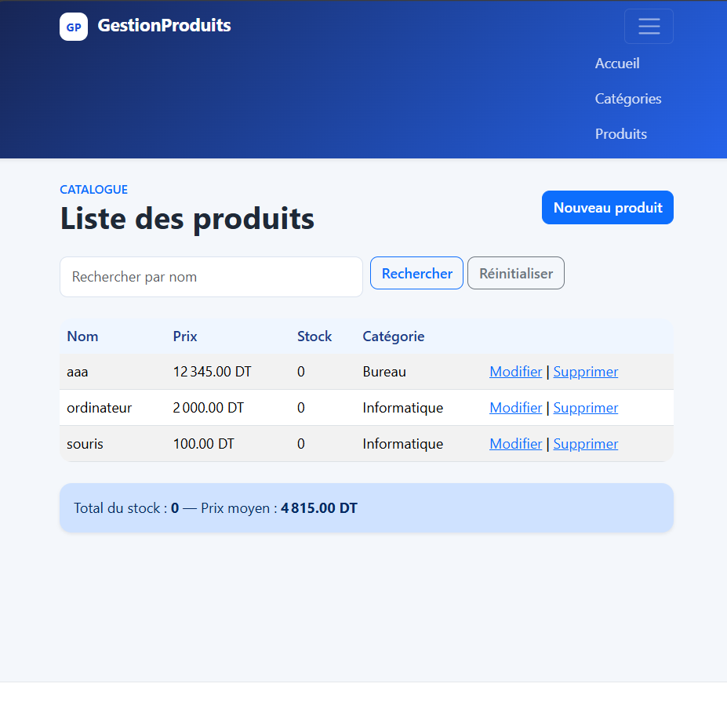
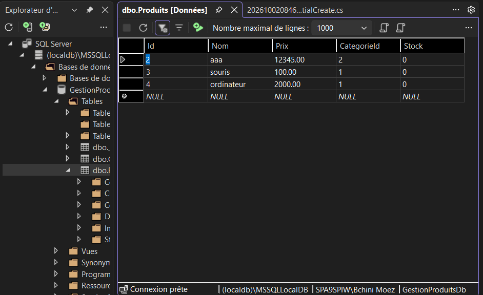
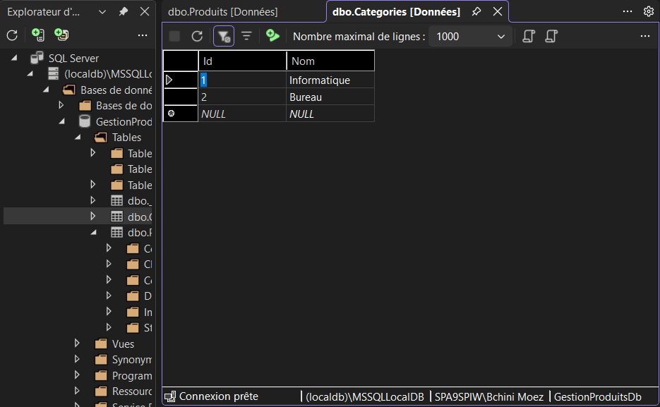
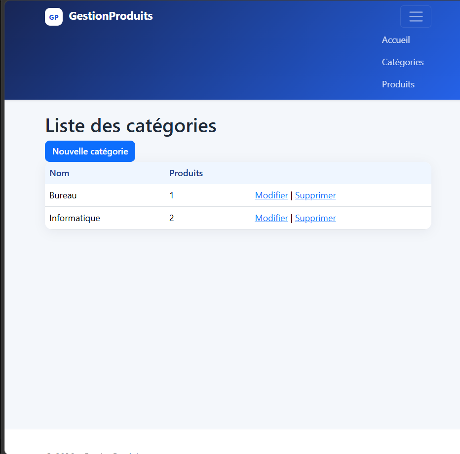
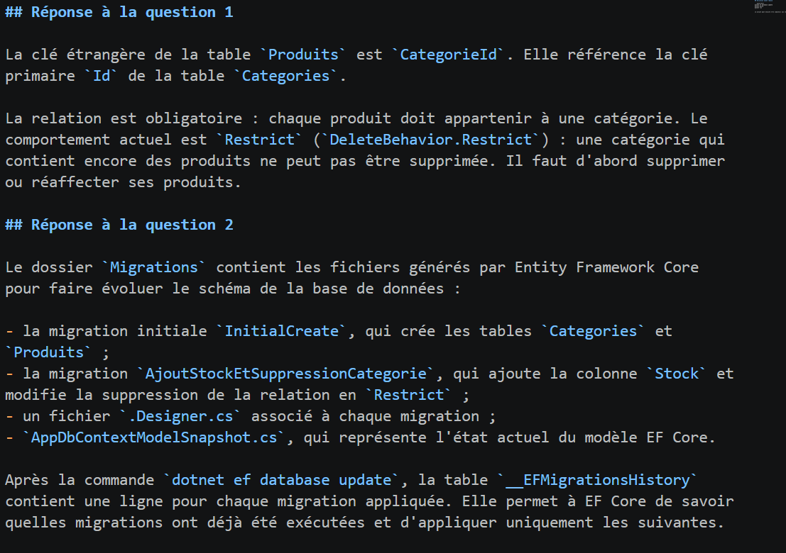

# GestionProduits

Application web de gestion de produits développée avec **ASP.NET Core Razor Pages**, **Entity Framework Core** et **SQL Server** selon l'approche **Code First**.

Le projet permet de gérer un catalogue de produits organisé par catégories, avec une interface claire, une recherche rapide et des indicateurs de stock et de prix.

## Aperçu



## Fonctionnalités

- Gestion complète des produits : ajout, consultation, modification et suppression.
- Gestion complète des catégories.
- Association obligatoire entre chaque produit et sa catégorie.
- Protection contre la suppression d'une catégorie contenant des produits.
- Recherche des produits par nom.
- Gestion du prix en dinars tunisiens (DT).
- Gestion et affichage du stock.
- Calcul du stock total et du prix moyen.
- Validation des formulaires côté serveur et côté client.
- Base de données SQL Server créée avec les migrations Entity Framework Core.
- Interface responsive basée sur Bootstrap avec une identité visuelle personnalisée.

## Captures d'écran

### Catalogue des produits

La page principale affiche les produits, leur prix en DT, leur stock, leur catégorie et les actions disponibles.


### Gestion des catégories



### Formulaire produit



### Base de données SQL Server



### Migrations Entity Framework Core



## Technologies utilisées

- .NET 10 / ASP.NET Core Razor Pages
- Entity Framework Core 10
- SQL Server LocalDB
- Bootstrap
- HTML, CSS et Razor
- Visual Studio

## Prérequis

- SDK .NET 8 ou supérieur
- SQL Server LocalDB, SQL Server Express ou SQL Server
- Visual Studio ou Visual Studio Code
- Outil Entity Framework Core :

```powershell
dotnet tool install --global dotnet-ef
```

## Installation

Cloner le dépôt puis accéder à son dossier :

```powershell
git clone https://github.com/moezbchini8-stack/GestionProduits.git
cd GestionProduits
```

Restaurer les dépendances :

```powershell
dotnet restore
```

Vérifier la chaîne de connexion dans `appsettings.json` :

```json
{
  "ConnectionStrings": {
	"DefaultConnection": "Server=(localdb)\\MSSQLLocalDB;Database=GestionProduitsDb;Trusted_Connection=True;TrustServerCertificate=True"
  }
}
```

Créer ou mettre à jour la base de données :

```powershell
dotnet ef database update
```

Lancer l'application :

```powershell
dotnet run
```

Puis ouvrir l'URL affichée dans le terminal, généralement `https://localhost:xxxx` ou `http://localhost:5080`.

## Organisation du projet

```text
GestionProduits/
├── Data/                # DbContext Entity Framework Core
├── Migrations/          # Historique des évolutions de la base
├── Models/              # Entités Produit et Categorie
├── Pages/
│   ├── Categories/      # CRUD des catégories
│   ├── Produits/        # CRUD, recherche et statistiques produits
│   └── Shared/          # Layout partagé de l'application
├── wwwroot/             # CSS, JavaScript et bibliothèques statiques
├── appsettings.json     # Configuration et chaîne de connexion
└── Program.cs           # Configuration de l'application
```

## Modèle de données

- `Categorie` : `Id`, `Nom` et collection de produits.
- `Produit` : `Id`, `Nom`, `Prix`, `Stock` et `CategorieId`.
- `CategorieId` est une clé étrangère obligatoire vers `Categories(Id)`.
- La suppression d'une catégorie est restreinte si elle contient des produits (`DeleteBehavior.Restrict`).

## Migrations

Les migrations principales sont disponibles dans le dossier `Migrations` :

- `InitialCreate` : création des tables `Categories` et `Produits`.
- `AjoutStockEtSuppressionCategorie` : ajout du stock et protection de la relation catégorie-produit.

Pour créer une nouvelle migration après une modification du modèle :

```powershell
dotnet ef migrations add NomDeLaMigration
dotnet ef database update
```

## Validation

Compiler le projet avec :

```powershell
dotnet build
```

Les dossiers générés `bin`, `obj` et `.vs` sont exclus du contrôle de version par `.gitignore`.

## Auteur

Projet réalisé dans le cadre d'un TP ASP.NET Core Razor Pages et SQL Server Code First.
